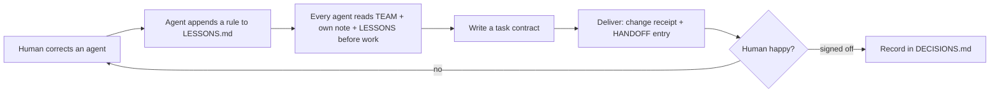

# AI Agent Team Playbook: shared rules, memory and handoffs for multi-agent workflows

Plain-text templates for one person running a team of AI coding agents (Claude Code, Cursor, Codex, or any multi-agent setup), so they stop forgetting things and stop repeating the same mistakes.

## The problem

Once you have more than one agent, things get messy fast:

- You correct a mistake on Monday. On Tuesday a different agent makes it again.
- Every new session starts from zero, and you explain the project all over again.
- Two agents edit the same file and one quietly overwrites the other.
- An agent says "done". It isn't done.

Reminding them every time doesn't scale. What worked for me was writing the rules down in files that every agent reads before it starts work. This repo is a generic version of those files.

## What's inside

```
templates/
  TEAM.md            shared team rules, every agent reads this first
  bots/_template.md  per-agent onboarding note: role, what it owns, what it never touches
  LESSONS.md         lessons log: one entry per human correction
  HANDOFF.md         append-only handoff log between agents
  DECISIONS.md       decisions the human signed off on; agents can't overrule them
  TASK-CONTRACT.md   written before work: goal, scope, definition of done
  CHANGE-RECEIPT.md  written after work: what changed and how it was verified
examples/
  fictional-blog-team/  a made-up 3-agent blog team, filled in
```

## The one loop that matters

Correct an agent once → it writes the rule into LESSONS.md → every agent reads LESSONS.md before work → the mistake doesn't come back.



Sounds obvious, I know. The part that actually makes it work is "whoever got corrected writes it down". Don't count on remembering it yourself. You won't.

A few things I learned the hard way:

- Write lessons as rules you can follow, not as feelings.
- Never edit HANDOFF history. Only append. You'll want the trail when something breaks.
- "Done" needs proof: the command that ran and what it printed.
- If you've decided something, put it in DECISIONS. Agents have to ask before changing it.

## Quick start (5 minutes)

1. Copy `templates/` into your project, e.g. as `team/`.
2. Edit `TEAM.md` and add your hard lines (things agents must ask you about first).
3. Copy `bots/_template.md` once per agent and fill in its role.
4. Add this to each agent's system prompt, `AGENTS.md`, `CLAUDE.md` or Cursor rules:
   > Before starting work, read team/TEAM.md, team/bots/<your-name>.md, team/LESSONS.md, team/DECISIONS.md and the last 20 entries of team/HANDOFF.md.
5. Next time an agent messes up, don't just fix it. Have it write the lesson into LESSONS.md.

Not sure what a filled-in version looks like? See `examples/fictional-blog-team/`. Everything there is invented.

## Works with

Claude Code, Cursor, Codex, Aider, custom multi-agent frameworks. It's just Markdown, so anything that can read a file can use it.

## FAQ

**How is this different from AGENTS.md or CLAUDE.md?**
Those usually describe one project for one agent. This adds the team layer: who owns what, how agents hand work to each other, and a shared memory of corrections. Point your AGENTS.md at these files.

**Does this give agents long-term memory?**
Sort of, the low-tech kind. LESSONS.md and DECISIONS.md are persistent memory that survives new sessions and is shared across agents. No vector database needed.

**Won't LESSONS.md get huge?**
Merge duplicates and keep each entry short. If a lesson only applies to one agent, move it into that agent's note.

**Do I need several agents for this to help?**
No. A single agent across many sessions benefits from LESSONS and HANDOFF too.

## 中文说明

一个人带一群 AI Agent 干活用的规则文件模板。核心就一条：你纠正一次，就写进 LESSONS.md，所有 Agent 开工前都读。纯 Markdown，Claude Code / Cursor / Codex 都能用。

Sibling repo, for making AI-written Chinese sound human: https://github.com/IMYin/chinese-human-voice

More skills for shipping and getting paid: https://getpaidskills.com/?utm_source=github&utm_campaign=ai-agent-team-playbook
